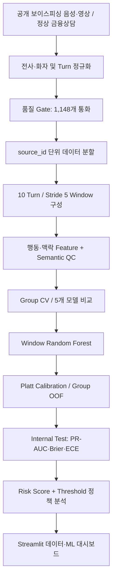

# Voice Phishing ML — 보이스피싱 위험도 분류·검증 파이프라인

> **통화 속 사칭·압박·정보 요구 등의 위험 신호를 데이터로 만들고, 최근 대화 구간에서 보이스피싱 위험을 분석하는 머신러닝 프로젝트**
>
> 공개 보이스피싱 음성·영상 및 정상 금융상담을 **Turn 표준화 → 10-Turn Window → Feature Engineering → 모델 비교 → Calibration → Risk Score → Streamlit 시각화**로 연결했습니다.

**2026.08 · 팀 프로젝트 · 팀장 / 데이터 수집·전처리 / EDA·Feature Engineering / 모델링·품질 검증 / Streamlit 대시보드**

**🌐 [배포된 Streamlit 대시보드 체험하기](https://voice-phishing-prevention.streamlit.app/)** · **[📖 상세 Notion 포트폴리오](https://app.notion.com/p/e5bc753ff28a83c0a566015296a2282c)** · **[🤝 연계 프로젝트: CSR | Case Share Room](https://github.com/hamhj7694/AIXTeamProject2)**

> [!IMPORTANT]
> **제한된 내부 실험 결과**입니다. 금융기관 상용 보이스피싱 탐지 정확도가 아니며, 정상 상담·피싱 통화 간 수집 출처 차이와 외부 일반화 한계가 남아 있습니다. 일부 대시보드 시연은 **최종 Random Forest 평가 파이프라인과 다른 모델 또는 규칙형 Feature 추출기**를 사용합니다.

---

## 01. 프로젝트 요약 및 주요 성과

| 항목 | 기록 | 집계·평가 기준 |
|---|---:|---|
| 공개 음성·영상 수집 | **513건** | 원천 자료 확보 |
| 음성 전사 | **402건** | 수집·전사 작업 기록 |
| 학습 가능한 통화 | **1,148건** | 피싱 766건 + 정상 382건 |
| 학습 Window | **7,406건** | 10-Turn 이상 968개 통화에서 생성 |
| **Window RF Validation PR-AUC** | **0.818** | 통화 균등 가중치(Case-equal) 기준 |
| **Platt 보정 후 Window Internal Test PR-AUC** | **0.782** | 내부 Test, Calibration 적용 |
| Internal Test 확률 품질 | **Brier 0.176 / ECE 0.028** | 낮을수록 좋은 확률 오차 지표 |

**513건 → 402건 → 1,148건**은 단일 데이터셋의 순차적인 전환 건수가 아닙니다. 1,148건은 보이스피싱과 정상 상담의 여러 원천 자료를 **추가 통합·정규화**한 최종 통화 단위 데이터셋입니다.

### 문제 정의 → 해결 접근

| 발견한 문제 | 해결 접근 |
|---|---|
| '송금·대출·계좌' 같은 단어는 정상 상담에도 등장 | 단순 키워드가 아니라 **사칭·압박·행동 요구와 신호 조합** 분석 |
| 자료마다 화자·발화 구조가 다름 | 공통 **Turn 구조** 변환 및 원본 Turn 수 품질 검사 |
| 같은 통화의 비슷한 Window가 학습/시험에 중복될 위험 | **source_id별 Group 분할** 및 Group-aware CV |
| 긴 통화가 Window 수만큼 모델에 과도한 영향 | **1 / 통화별 Window 수**로 통화 균등 가중치 적용 |
| 분류 점수를 실제 위험 확률처럼 해석하기 쉬움 | **Calibration**과 위험 경고 **Threshold 정책** 분리 |
| 수집 출처의 문체·길이 차이를 학습할 위험 | 출처·길이 Proxy 진단 및 Feature 제외 |

---

## 02. 데이터 구축 — 원문에서 Window까지

### Turn 표준화와 품질 검사

- **보이스피싱 자료:** 발화 순서·화자·텍스트를 공통 Turn 구조로 정리
- **정상 금융상담:** TX/RX 마커로 발화 순서를 복원; **383건 중 382건** Turn 수 정확 일치(**99.74%**)
- **품질 Gate:** 원본 Turn 수와 복원 결과가 불일치하는 통화를 제외
- **최종 데이터:** 피싱 통화 766건 + 정상 통화 382건 = **1,148건**

10 Turn 이상 통화만 대상으로 **Window 길이 10 Turn, Stride 5 Turn**의 학습 샘플을 구성했습니다. 10 Turn 미만 통화는 억지로 패딩하거나 부분 Window로 추가하지 않았습니다.

### 통화 ID 기준의 Train / Validation / Test

데이터 누수 가능성을 줄이기 위해 **통화 단위로 Train 70% / Validation 15% / Test 15%**를 먼저 구분하고, 같은 `source_id`에서 생성된 모든 Window가 같은 Split에 속하게 했습니다.

| Split | Window 생성 통화 | Window 수 |
|---|---:|---:|
| Train | 691 | **5,492** |
| Validation | 143 | **882** |
| Test | 134 | **1,032** |
| **합계** | **968** | **7,406** |

학습 단계에서는 통화별 Window 개수 차이와 정상·피싱 클래스 불균형을 함께 고려했습니다. Train 내부 OOF 예측은 **StratifiedGroupKFold 5-Fold** 기반으로 설계했습니다.

---

## 03. Feature Engineering 및 Semantic QC

단어 빈도만으로 판단하지 않도록 Window에서 **12개 행동·맥락 Feature**를 추출해 비교했습니다.

| Feature 영역 | 대표값 | 의미 |
|---|---|---|
| 사칭·신원 주장 | `imp_public`, `imp_financial` | 공공·금융기관 신원 주장 |
| 심리적 압박 | `strategy_authority`, `strategy_fear` | 권위·공포 전략 |
| 정보 요구 | `strategy_info_extraction_sem`, `sensitive_info_request_sem`, `auth_info_request_sem` | 정보·인증정보 제공 유도 맥락 |
| 다양성 | `strategy_diversity_sem`, `action_diversity_sem` | 신호 및 요구 행동의 종류 |
| 결합 효과 | `ix_identityclaim_authority_sem`, `ix_info_sensitive_sem` | 사칭×권위, 정보 추출×민감정보 요구 |
| 변화량 | `signal_family_count_delta_sem` | 이전 Window 대비 위험 신호 변화 |

**Semantic QC**에서는 일반 금융 안내나 예방 경고를 위험 요청으로 잘못 분류하지 않도록 Positive / Negative 기준을 나누었습니다.

| 후보 분류 | 건수 |
|---|---:|
| RISK_POSITIVE | 1,245 |
| NORMAL_WARNING_OR_ROUTINE | 886 |
| NEUTRAL_MENTION | 323 |
| AMBIGUOUS | 230 |
| **합계** | **2,684** |

위 숫자는 **의미 검토 후보의 분포**이지 ML 분류 정확도가 아닙니다.

Feature 후보의 승격은 **통계검정 → FDR 보정 → 단일 Feature AUC → 5-Fold 방향 안정성**을 검토하고, 통화 길이·문자 스타일·데이터 출처를 노출하는 Proxy 변수는 모델 입력에서 제외했습니다.

---

## 04. 머신러닝 모델 비교

모델 선정에서 특정 Threshold에 따른 Accuracy보다 **Validation PR-AUC**를 1차 기준으로 사용했습니다.

| 모델 | Validation PR-AUC (Case-equal) | Validation ROC-AUC (Case-equal) |
|---|---:|---:|
| **Random Forest — 선택** | **0.818** | **0.778** |
| LightGBM | 0.814 | 0.773 |
| XGBoost | 0.813 | 0.775 |
| Logistic Regression | 0.813 | 0.771 |
| Decision Tree | 0.803 | 0.752 |

**Random Forest**를 Window 모델로 선택했습니다. 모델 간 PR-AUC 차이는 크지 않으므로 다른 데이터에서도 항상 우수하다는 의미는 아닙니다.

**평가 근거:** [모델 비교 CSV](dashboard/data/ml_validation/window_model_comparison.csv)

### Calibration — 확률 품질의 별도 검증

Window 모델의 기본 예측 확률을 보정하기 위해 Identity / Platt Scaling / Isotonic Regression을 비교하고 **Platt Scaling**을 선택했습니다.

| Window Calibration | Brier ↓ | Log Loss ↓ | ECE ↓ |
|---|---:|---:|---:|
| 보정 없음 | 0.216 | 0.600 | 0.190 |
| **Platt Scaling** | **0.179** | **0.513** | **0.057** |
| Isotonic | 0.180 | 0.547 | 0.087 |

**Platt Calibration 적용 후 Internal Test**

| 지표 | 값 |
|---|---:|
| **PR-AUC** | **0.782** |
| ROC-AUC | 0.772 |
| **Brier Score** | **0.176** |
| Log Loss | 0.513 |
| **ECE** | **0.028** |

`Risk Score = Calibrated Probability × 100`. 하지만 이는 **해당 내부 데이터 분포에서 보정된 상대적 위험 점수**이지, 실제 통화가 보이스피싱일 절대 확률은 아닙니다.

**평가 근거:** [Calibration Manifest](dashboard/data/ml_validation/calibration_manifest_07.json)

### Threshold 정책과 Calibration은 별개

저장소의 08단계에는 **Window 69점 / SINGLE(1개 Window)** 경고 기준을 선택한 실험 기록이 있습니다. 이 설정은 **`COMPROMISE`(절충)**로 표시돼 있으며, 목표 Recall과 FPR을 동시에 충족한 운영 정책이 아닙니다.

| 내부 경고 정책 평가 | 통화 수준 Recall | 정상 통화 FPR |
|---|---:|---:|
| Validation | 0.644 | 0.107 |
| Internal Test | 0.532 | 0.105 |

**PR-AUC 0.782가 곧 경고 정책의 Recall 78.2%를 의미하지 않습니다.** 향후 다른 출처 데이터로 Threshold·연속 Window 경고정책을 재검증해야 합니다.

**근거:** [Threshold Policy JSON](dashboard/data/ml_validation/threshold_policy_config_08.json)

---

## 05. AI·ML 처리 아키텍처

아래 도식은 **누수 방지를 우선한 논리적 평가 구조**를 나타냅니다. 실제 파일 생성 명령의 시간 순서를 뜻하지 않습니다.



**범위 구분:** 대시보드에는 통화 종료 후 전체 문맥·Window 예측 흐름을 활용하는 **Case 보조 모델(STACKED_SAFE)**도 있습니다. 통화 중 위험 갱신을 목표로 한 Window 모델과 사용 시점이 달라 두 모델의 지표를 단순 비교하지 않습니다.

또한 `Window Logistic` 실험 데모는 별도 **실험용 샘플**을 사용합니다. 최종 Window Random Forest + Platt Calibration의 PR-AUC 수치를 해당 데모 성능이라고 주장하지 않습니다.

---

## 06. Streamlit 대시보드 및 서비스 적용 검토

**🌐 [대시보드 열기](https://voice-phishing-prevention.streamlit.app/)**

| 화면 | 주요 내용 |
|---|---|
| 데이터 소개·전처리 | 원본 출처, 통화·Turn 정리, 품질 검사 |
| 피해·통화 분석 | 경찰청·우체국 통계와 통화 분석을 **서로 다른 데이터로 구분**해 표시 |
| ML 검증 | 모델 비교, Feature, Calibration, Threshold 정책 시각화 |
| 위험도 시연 | 실험용 입력·모델을 통한 위험 신호 탐색 |

**중요한 재현 범위:** [대시보드의 일부 Feature 추출 코드](dashboard/services/feature_extractor.py)는 `RULE_PROXY_V1`이고 `EXTRACTOR_MATCHES_TRAINING_PIPELINE = False`로 정의되어 있습니다. 즉, **사용자 입력 데모의 Feature 추출 방식은 원래 최종 모델 학습 파이프라인과 동일하지 않습니다.** 시연 점수를 실제 상용 수준의 판정 결과로 해석해서는 안 됩니다.

현행 UI와 맞지 않는 예전 캡처를 현재 화면처럼 표시하지 않도록, README에는 스크린샷을 임의 추가하지 않았습니다.

**구현 코드:** [대시보드 진입점](dashboard/app.py) · [ML 성능 분석 화면](dashboard/components/ml_validation.py) · [위험도 추론](dashboard/services/detection_service.py) · [모델 로더](dashboard/services/model_loader.py)

---

## 07. 기술 스택과 개인 기여

| 영역 | 기술 | 내용 |
|---|---|---|
| 데이터·전사 | Python · FFmpeg · faster-whisper · pyannote | 공개 미디어 수집, STT·화자·Turn 정리 |
| EDA·Feature | Pandas · NumPy · SciPy · statsmodels | 데이터 품질·출처 편향, 위험 특징 분석 |
| ML 학습 | scikit-learn · XGBoost · LightGBM · Joblib | 분류 모델 비교와 번들 관리 |
| 평가·검증 | Group CV · PR-AUC · Brier · ECE | 누수 통제, Calibration, 정책별 Recall/FPR |
| 대시보드 | Streamlit · Plotly · Matplotlib | 데이터·모델·검증 정보 시각화 |
| 연계 검토 | OpenAI API · JSON Schema · CSR PoC | 구조화 위험 신호 및 다른 서비스로의 적용 가능성 검토 |

**팀 프로젝트 · 팀장:** 문제 정의, 공개 데이터 확보·전처리와 데이터 품질 정리, Feature/모델 검증 협업, Streamlit 대시보드 구조 설계 및 기능 통합을 수행했습니다. **정량 성과는 팀 프로젝트 전체의 내부 평가 결과**이며, 모든 데이터 수집·모델 학습 코드가 한 사람의 단독 구현이라는 뜻은 아닙니다.

---

## 08. 실행 및 저장소 구조

### 대시보드 로컬 실행

```bash
git clone https://github.com/hamhj7694/AIXTeamProject1.git
cd AIXTeamProject1
python -m venv .venv
# 가상환경 활성화 후
pip install -r dashboard/requirements.txt
streamlit run dashboard/app.py
```

[`dashboard/requirements.txt`](dashboard/requirements.txt)에는 `scikit-learn==1.8.0`이 지정돼 있습니다. 신뢰된 Joblib 모델 파일만 로드하세요. 모델/의존성 버전이 다르면 로딩이 실패할 수 있고, 일부 시연 기능에는 OpenAI API 설정이 필요할 수 있습니다.

> 이 명령은 **대시보드 실행**용입니다. 공개 미디어 전체 재수집 → 원본 STT → Colab의 학습·튜닝 → 모델 번들 생성 과정을 단일 명령으로 재현하지는 않습니다.

```text
AIXTeamProject1/
├── a_함형준/                       # 개인 작업안, 최종·실험용 모델 파일
├── b_엄정희/                      # 팀 작업 폴더
├── c_이종열/                      # 가설 검정·분석 자료
├── 2. 우체국, 경찰 공개 데이터 전처리/
├── 원문 추출/                     # 수집, STT, 결과 검토, 구축 문서
└── dashboard/
    ├── app.py
    ├── components/               # Streamlit 화면
    ├── services/                 # 모델 로드·Feature·추론
    ├── models/                   # 분석용 번들
    └── data/ml_validation/       # 모델 비교·Calibration·Threshold 지표
```

주요 근거: [Window 모델 비교](dashboard/data/ml_validation/window_model_comparison.csv) · [Calibration](dashboard/data/ml_validation/calibration_manifest_07.json) · [경고 정책](dashboard/data/ml_validation/threshold_policy_config_08.json) · [원문 추출](%EC%9B%90%EB%AC%B8%20%EC%B6%94%EC%B6%9C/2.%20%EC%BD%94%EB%9E%A9%20%ED%99%9C%EC%9A%A9%20%EC%9D%8C%EC%9B%90%20%ED%85%8D%EC%8A%A4%ED%8A%B8%ED%99%94/transcribe_cases.py)

---

## 09. 한계 및 다음 과제

- **Source Bias:** 정상·피싱 통화 출처의 문체·길이·숫자 표현 등이 여전히 다를 수 있습니다.
- **외부 독립 Test 부재:** 일부 Feature 검토에 동일 출처 데이터가 사용되어 Internal Test를 외부 일반화 검증으로 볼 수 없습니다.
- **경고 정책:** 현재의 절충 Threshold는 목표 Recall·FPR을 동시에 만족하지 못했습니다.
- **Demo 파이프라인 차이:** 일부 시연용 추출기·실험 모델은 최종 평가 조건과 다릅니다.
- **향후 검증:** 다양한 정상/Hard Normal·새 피싱 사례 확보, 외부 Test, 분포 변화 Calibration, Drift, 운영 비용·정책 검토가 필요합니다.
- **안전 경계:** Streamlit 대시보드는 분석·평가·시연 도구이며 실제 금융거래 차단·지급정지를 수행하는 시스템이 아닙니다.

## 포트폴리오 요약

> 서로 다른 공개 통화 데이터를 표준화하고 데이터 누수·출처 편향·Feature 품질·확률 신뢰성을 분리해 검증한 **보이스피싱 위험도 분류 ML 파이프라인**입니다. 내부 Validation에서 Window Random Forest **PR-AUC 0.818**, Platt 보정 후 Internal Test에서 **PR-AUC 0.782**를 기록하고, 이를 Streamlit 대시보드로 시각화했습니다. 수치는 제한된 내부 평가입니다.
